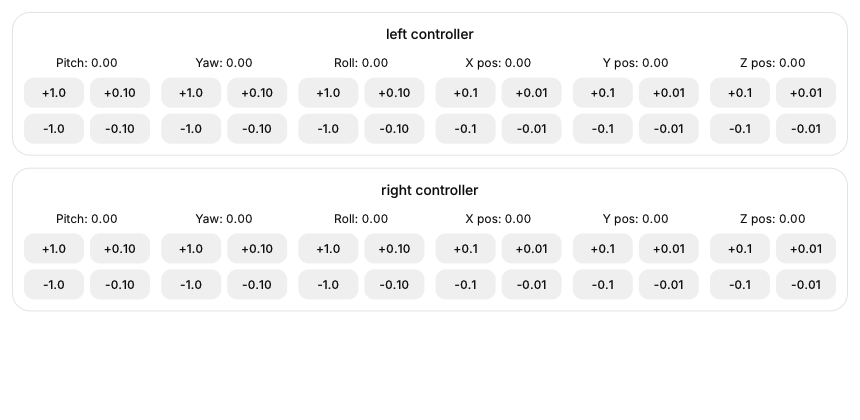

# openxr_loader.dll proxy

A proxy dll to Khronos openxr_loader.dll. (https://registry.khronos.org/OpenXR/specs/1.0/loader.html)

video description and demonstration here: https://www.youtube.com/watch?v=WixaeDdFIWg

it exposes bilateral comunications between the XR aplication and the OpenXR api, allowing the user to change inputs and outputs to OpenXR.

the target here is to implement a setting (per game) of controller rotation and position offsets. 
I personally think every vr game should have this as an option the same way desktop mouse driven first person shooters have mouse sensitivity settings.

https://github.com/aruametello/openxr_loader-dll-proxy/assets/25987323/0478a50b-3348-48ee-9340-1d7ea83c6feb

in short: "i will do my own settings, with blackjack and hookers".

This could serve as a starting point for a more complex tool to tweak everything between OpenXR and aplication, like OpenVR Advanced Settings does for OpenVR.

ideas that i desire to explore in the future:
 * filter inputs (remove shaky hands) under certains scenarios.
    - tiny input to the trigger finger would enable the filter.
    
 * OpenXR does have "full hand poses" support, could we use those for anything interesting? (perhalps injecting an external data source or using REALLY custom hand posess)
 

# Compiling:

the precompiled binaries were made using msys2 mingw64-ucrt, but is likely that other compilers will work as well.

the makefile has a target named "dll_release" that produces the desired, required dll file for the proxy ("dll_debug" does the same with debug symbols).

the interface is built on top of [CUI](https://github.com/yappologistic/CUI), which is vendored in third_party/ along with the Khronos openxr headers, so nothing external is needed to build.

the offsets themselves are not tied to a specific controller: the model just tracks whatever the runtime maps into the "left hand" and "right hand" spaces, and the offsets get applied to those spaces. the interface shows the two spaces, and names the controller that is actually in them when the runtime tells us (interaction profile).

to develop the interface without booting a vr game, the makefile can spawn it directly with a mocked session:

* `ui` (alias for `ui_debug`, or `ui_release`) builds the standalone interface exe (src/ui_main.c + src/ui.c) in obj/Ui/.
* `ui_run` builds it and opens the window (it stays open until closed; every click saves the config).
* `ui_shot` builds it and renders a screenshot to obj/Ui/ui.png, then exits — handy for checking the layout in one go.