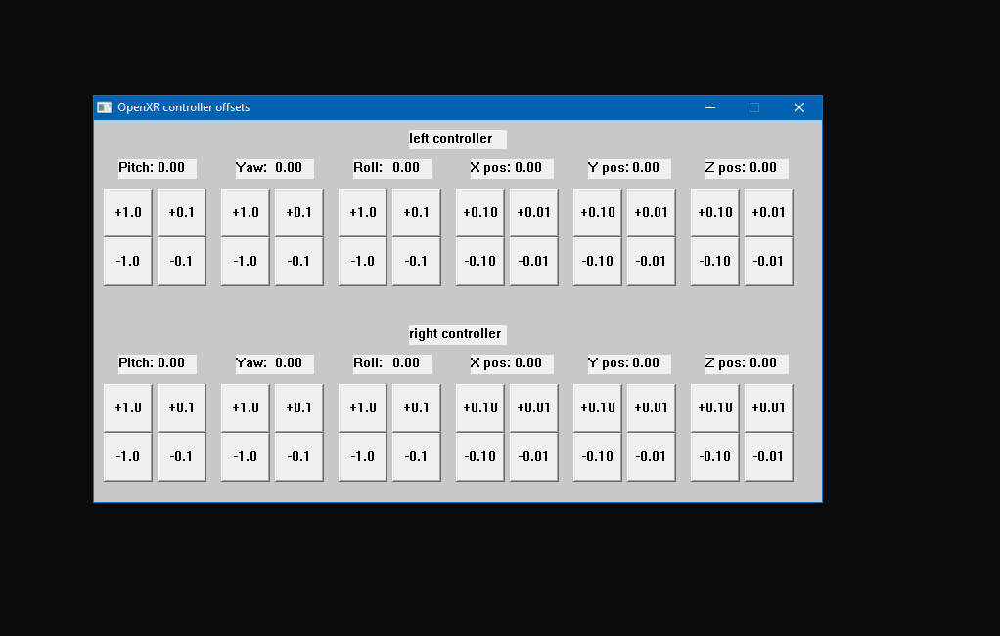

# openxr_loader.dll proxy

A proxy dll to Khronos openxr_loader.dll. (https://registry.khronos.org/OpenXR/specs/1.0/loader.html)

video description and demonstration here: https://www.youtube.com/watch?v=WixaeDdFIWg

it exposes bilateral comunications between the XR aplication and the OpenXR api, allowing the user to change inputs and outputs to OpenXR.

the target here is to implement a setting (per game) of controller rotation and position offsets. 
I personally think every vr game should have this as an option the same way desktop mouse driven first person shooters have mouse sensitivity settings.

https://github.com/aruametello/openxr_loader-dll-proxy/assets/25987323/0478a50b-3348-48ee-9340-1d7ea83c6feb

in short: "i will do my own settings, with blackjack and hookers".

This could serve as a starting point for a more complex tool to tweak everything between OpenXR and aplication, like OpenVR Advanced Settings does for OpenVR.

ideas that i desire to explore in the future:
 * filter inputs (remove shaky hands) under certains scenarios.
    - tiny input to the trigger finger would enable the filter.
    
 * OpenXR does have "full hand poses" support, could we use those for anything interesting? (perhalps injecting an external data source or using REALLY custom hand posess)
 

# Compiling:

the precompiled binaries were made using msys2 mingw64-ucrt, but is likely that other compilers will work as well.

the makefile has a target named "dll_release" that produces the desired, required dll file for the proxy.

## BONELAB controller-local translation patch

This checkout is based on [aruametello/openxr_loader-dll-proxy](https://github.com/aruametello/openxr_loader-dll-proxy). In `xrLocateSpace`, position offsets are rotated by the incoming tracked hand orientation using OpenXR's X-Y-Z component order before being added to each hand pose. This makes position-only offsets controller-local. Configured rotation offsets continue to affect orientation as before.

For the tested BONELAB setup, configure both `left_hand_position_offset_y` and `right_hand_position_offset_y` to `-0.050800` in the game's `openxr_loader_config.txt`. The build in `obj/Release/openxr_loader.dll` is the proxy DLL; install it as `openxr_loader.dll` beside `original_openxr_loader.dll`.

### Authorship

The controller-local translation code in this patch was written by an AI assistant using Copilot SDK in VS Code. The person requesting the fix contributed no code; they provided the issue description and in-game test results.
